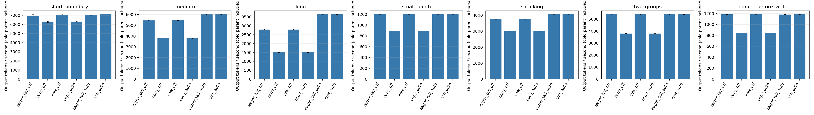

# Shared-context nano-vLLM

面向共享文档、多轮对话与会话分支的单 GPU 推理引擎优化：**Triton 共享前缀 Attention、KV Cache COW、成本感知调度**，以及可选 GPU/CPU 分层缓存。

基于 [GeeeekExplorer/nano-vllm](https://github.com/GeeeekExplorer/nano-vllm) 提交 `bb823b3e06983d71485a8e1f23715ebd87d98ef8` 开发。保留 MIT 许可证及[上游 README](README.upstream.md)。上游已有分页、前缀缓存、CUDA Graph 不作为新增贡献；共享 Attention 分解参考 Hydragen / FlashInfer 等工作，不宣称算法首创。

[完整报告](docs/FINAL_REPORT.md) · [原始数据说明](results/README.md) · [会话接口](docs/KV_SESSIONS.md) · [原服务器复现记录](README.shared-context.md)

## 核心实现

- **算子**：Triton 跨请求共享 K/V 加载，前缀/私有后缀分段计算与 FP32 LSE 合并；非连续分页、变长后缀、Graph 动态元数据与自动回退。
- **缓存**：精确前缀链身份、物理页 generation、引用所有权、尾页写时复制、会话 fork/pause/resume/cancel、淘汰与失败回滚。
- **调度**：Prefill/Decode 成本查表与在线修正、有界共享分组、Decode 服务间隔保护、冷请求等待保护、过载准入。
- **分层**：有界 pinned pool、GPU 暂存、独立传输流、完成事件后发布、恢复/重算成本选择；仅迁移零活跃引用的完整页。

## 主要实测结果

RTX 4090 24GB，Qwen3-0.6B FP16；完整预热后各配置重复 3 次，表中为中位数。模型激活/KV 为 FP16，残差为 FP32，禁用 FP16 reduced-precision GEMM reduction。

| 场景与对照 | 结果 | 边界 |
|---|---|---|
| 完整 Attention：B=64，前缀/后缀=4096/128，CUDA Graph | FlashAttention **490µs → 自研 143µs（3.43×）** | 包含私有后缀与 merge；FlashInfer 约 36µs，更快 |
| 4223-token 父历史，32 分支×64 输出，含冷 Prefill | 全拷贝 **1501 → COW+auto 3657 tok/s（2.44×）** | 全拷贝控制组，不是原始上游；活跃 KV 页 561→49，不等于进程显存下降 |
| 冷热混合开放到达，联合调度 vs 固定 1024-token chunk | 吞吐 **+31.2%**，冷请求 P95 TTFT **−46.8%** | 固定负载和调度对照，非任意流量保证 |



完整方案在本轮因果多轮回放中没有超过冻结上游；CPU 强制恢复在 0.6B 配置无吞吐收益。保留全部消融与负对照，不据局部结果宣称普遍领先。0.6B/4B FP16 数值验收通过；4B 的共享路径仅 force 验证，自动策略仍回退；BF16 引擎使用普通 Attention 回退。

## 环境与安装

复现实测环境为 Linux x86_64、Python 3.10、CUDA toolkit 12.1/nvcc、Torch 2.5.1+cu121、Triton 3.1.0、FlashAttention 2.7.4.post1、Transformers 4.57.1。需要独占 NVIDIA GPU；主实验使用 24GB 显存。不要在 macOS/CPU 上执行 GPU 实验。

```bash
git clone https://github.com/jryxxx/nano-vllm.git
cd nano-vllm
python3.10 -m venv .venv
source .venv/bin/activate
python -m pip install --upgrade pip setuptools wheel
python -m pip install torch==2.5.1 --index-url https://download.pytorch.org/whl/cu121
python -m pip install -r requirements-reproduce.txt
python -m pip install flash-attn==2.7.4.post1 --no-build-isolation
python -m pip install --no-deps -e .
```

FlashAttention 需要匹配 Python/Torch/CUDA/ABI；原实验使用匹配 wheel，源码构建需要 nvcc。原始 `pip freeze` 含服务器本地 wheel 路径，是环境证据，**不能直接作为跨机器安装文件**，详见 [environment](results/finalization/environment/)。安装后以实际验证为准，不保证任意驱动组合。

模型使用官方 `Qwen/Qwen3-0.6B` 的权重与 tokenizer。创建本地副本（或权重软链接目录），把 `config.json` 中 `torch_dtype`（若有 `dtype` 也同步）设为 `float16`，得到本项目使用的 FP16 加载目录。无需将权重提交 Git；模型文件校验见 `results/finalization/environment/models.json`。

## 运行与复现

以下入口支持任意绝对模型路径，`PYTHON` 可指定解释器。实验串行执行，不要同时启动其他 GPU 负载。

```bash
# 给 B0 原始上游对照准备独立、固定提交的源码
mkdir -p vendor
git clone https://github.com/GeeeekExplorer/nano-vllm.git vendor/nano-vllm-upstream
git -C vendor/nano-vllm-upstream checkout bb823b3e06983d71485a8e1f23715ebd87d98ef8

# 新环境必须重新标定：成本表校验模型路径、配置 SHA、精度、Torch/CUDA/GPU
bash scripts/reproduce.sh /absolute/path/Qwen3-0.6B-fp16 calibrate
bash scripts/reproduce.sh /absolute/path/Qwen3-0.6B-fp16 verify
bash scripts/reproduce.sh /absolute/path/Qwen3-0.6B-fp16 bench
# 或依次运行以上三步
bash scripts/reproduce.sh /absolute/path/Qwen3-0.6B-fp16 all
```

`bench` 覆盖 B0/B1/B2/M/K/S/Full/Tiered、Full 逐项关闭、缓存/分层、开放到达和分支消融。结果写入 `results/finalization`，会覆盖同名文件；已发布结果固定在 Git 历史/Release 中。只运行部分实验后，不应把未重跑文件与新结果合成一次新实验。

单独运行关键实验：

```bash
export PYTHONPATH="$PWD"
python experiments/bench_combined.py --model /absolute/path/Qwen3-0.6B-fp16 \
  --output results/my-branch-ablation.json --repeats 3
python experiments/replay_prefill.py --model /absolute/path/Qwen3-0.6B-fp16 \
  --profile results/finalization/cost-profile.json --output results/my-openloop.json --repeats 3
python tests/validate_engine_shared.py --model /absolute/path/Qwen3-4B-fp16 \
  --backend force --output results/my-4b-validation.json
```

数据汇总与图表（已发布完整结果集可直接运行，不需要 GPU）：

```bash
python experiments/summarize_release.py
```

外部参考分别运行，不往主环境安装 vLLM 的依赖：

```bash
# FlashInfer 0.2.5：另建 target 目录，基于主环境 Torch 2.5.1，需 nvcc
python -m pip install --no-deps --target /absolute/flashinfer-ref flashinfer-python==0.2.5
PYTHONPATH="/absolute/flashinfer-ref:$PWD" MAX_JOBS=4 TORCH_CUDA_ARCH_LIST=8.9 \
  python experiments/bench_flashinfer.py

# vLLM 0.8.5 在独立环境（Torch 2.6/CUDA12.4），精确版本见 vllm-reference-requirements.txt
python3.10 -m venv /absolute/vllm-env
/absolute/vllm-env/bin/python -m pip install vllm==0.8.5 transformers==4.51.3 \
  huggingface-hub==0.30.2 tokenizers==0.21.4 openai==1.76.0
VLLM_USE_V1=0 VLLM_NO_USAGE_STATS=1 DO_NOT_TRACK=1 \
  /absolute/vllm-env/bin/python experiments/bench_external_engine.py \
  --backend vllm --model /absolute/path/Qwen3-0.6B-fp16 --output results/my-vllm.json
```

`experiments/run_release_measurements.sh` / `reproduce.sh` 保留原服务器的完整路径，适合核对历史命令；新机器优先使用 `scripts/reproduce.sh`。历史诊断脚本依赖其当时快照，并非所有诊断都适用于当前环境。

## 验证与数据

- 576 次缓存/重算 logits 检查、2680 次 Prefill/调度检查；最终最大相对 L2 分别为 0.003704 / 0.003083，既定门槛 0.005 未放宽。
- 37 个分页算子边界用例、8 次动态 Graph replay、18 个联合路径用例；33 条贪心回归共 528 token 一致。
- 270 次 CPU 缓存逐位检查，覆盖真实复制后失败、传输中取消和回滚；D2H/Decode 时间线有实际重叠。
- 原始 JSON 含请求 token 时间、重复次数、路由/资源统计；CSV、PNG/SVG、固定版本参考、失败候选记录全部保留。
- 输入是固定种子 shape 压测、程序生成技术文本及 teacher-forced 会话响应，不是真实用户生产对话；详见[数据说明](results/README.md)。

GPU 硬件 counters 不可用，不报告 HBM/L2/occupancy 实测。当前为单 GPU、单线程 step 边界 API；CPU 缓存不迁移保存或活跃会话。多 GPU、MoE、KV 量化、LoRA、推测解码和多层前缀树 kernel 不在范围内。
